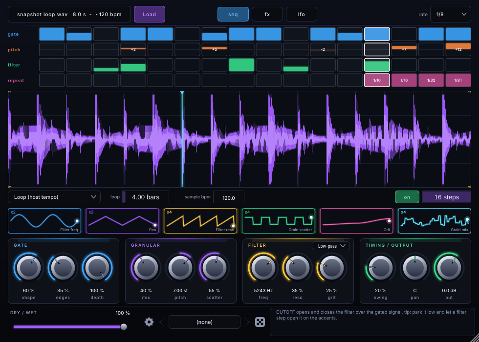

# Mangle

A **sample-mangler instrument** for **Logic Pro on macOS** (Audio Unit `aumu`, JUCE 8 / C++17). Drag any audio file onto
it and chop, pitch, grain, filter, crush and repeat it in time with the project, live.



It is a tool for working with audio you already have the right to use. It makes no claim about what any file sounds
like or whether any sample is cleared; that is up to you.

## What it does

- **Load anything:** drop a file on the window or press *Load*. WAV, AIFF, FLAC, MP3, OGG, and on macOS also M4A / AAC / CAF.
  The waveform is drawn with a beat grid and a live playhead. Drag the yellow markers to play only part of the file.
- **Three play modes:** *Loop (host tempo)* loops the sample in time with Logic while the transport runs (stretched to the
  *loop* length in bars, pitch stays put); *Loop on MIDI note* does the same while a key is held; *Keys* plays it like a
  sampler, with the played note setting the pitch (root note adjustable, optional one-shot).
- **Tempo:** a rough tempo (and loop length in bars) is detected when a loop is loaded. You can always type the sample's
  own BPM or set the loop length by hand.
- **Step sequencer:** 16 steps at 1/4, 1/8, 1/16, 1/32 or triplets, with four lanes: *gate*, *pitch* (+-12 st per step),
  *filter* (opens the cutoff on that step) and *repeat* (beat-repeat division per step). Swing, and a pattern length of 1-16 steps.
- **Effects:** pitch (semitones + fine), release, granular (mix, pitch, scatter, size, density), gate shaping (shape,
  edges, depth), low-/high-pass filter with resonance, grit (distortion), beat repeat (1/4 to 1/32 and triplets, with gate),
  reverb (size, damp, mix), pan, output level, dry/wet.
- **Six LFOs** locked to the song position (8 bars down to 1/32), each aimed at any one control.
- **Randomise** button and ten factory presets (they show up as Logic's plug-in presets).
- Every control is an **automatable AU parameter**. The project stores all settings, the pattern, and the sample: its
  path, plus a copy of the file inside the project when it is 6 MB or smaller. If the original file has moved, Mangle
  uses the embedded copy and tells you; if it is missing and nothing is embedded, it says so and you can drop the file again.
- Audio thread: no allocation, no locks. The DSP core has no JUCE dependency and is unit-tested on Linux.

> **Status (v0.1.0-dev).** DSP core, state handling, sample loading and the editor are unit-tested on Linux, and a macOS
> workflow ([`.github/workflows/macos-au.yml`](.github/workflows/macos-au.yml)) builds the universal AU on `macos-14` and
> runs `auval`. The AU has **not yet been tried inside Logic Pro**.

## Build (macOS, for Logic)

Requirements: macOS 11+, Xcode 14+ command-line tools, CMake >= 3.22 (`brew install cmake ninja`). JUCE 8.0.15 is
downloaded by CMake.

```bash
git clone https://github.com/Pak209/mangle.git
cd mangle
cmake -S . -B build -G Ninja -DCMAKE_BUILD_TYPE=Release -DCMAKE_OSX_ARCHITECTURES="arm64;x86_64"
cmake --build build --target Mangle_AU Mangle_Standalone
```

Output: `build/plugin/Mangle_artefacts/Release/AU/Mangle.component` (and a Standalone app next to it). Options:
`-DMANGLE_VST3=ON` adds VST3, `-DMANGLE_COPY_AFTER_BUILD=ON` installs after each build (ad-hoc signed),
`-DMANGLE_DISTRIBUTION=ON` is for the release pipeline (see [docs/RELEASING.md](docs/RELEASING.md)).

In Logic: create a **Software Instrument** track, click the instrument slot, *AU Instruments > Pak209 > Mangle*.
The plug-in identifies itself as `aumu Mngl Pk20`, bundle `com.dkimoto.mangle`.

## Linux (tests, standalone, screenshots)

```bash
cmake -S . -B build -G Ninja -DCMAKE_BUILD_TYPE=Release
cmake --build build
ctest --test-dir build --output-on-failure          # core DSP tests + plug-in tests
xvfb-run -a build/plugin/MangleSnapshot_artefacts/Release/MangleSnapshot shot.png seq   # UI screenshot (test data)
cmake --build build --target MangleSnapshot         # (dev tool, not built by default)
```

The JUCE-free DSP core alone: `cmake -S . -B build-core -DMANGLE_BUILD_PLUGIN=OFF && cmake --build build-core && ./build-core/core/mangle_core_tests`.

## Diagnostics

Mangle writes a small log at `~/Library/Logs/Mangle/mangle.log` (sample loads, problems, versions). The gear menu has *Show log file*.

## Layout of the repo

- `core/`: JUCE-free DSP (`Dsp.*` filters, reverb, grains, beat repeat, tempo detection; `Engine.*` the sound engine) and its tests.
- `plugin/`: JUCE plug-in (parameters, presets, sample loader, state, editor) and its tests / snapshot tool.
- `docs/`: licences and release notes.

## Licence

**GNU AGPL v3.0** (see `LICENSE`). Built on JUCE 8 under its AGPLv3 option; UI font Inter under the SIL OFL 1.1.
Details: [docs/LICENSES.md](docs/LICENSES.md).
